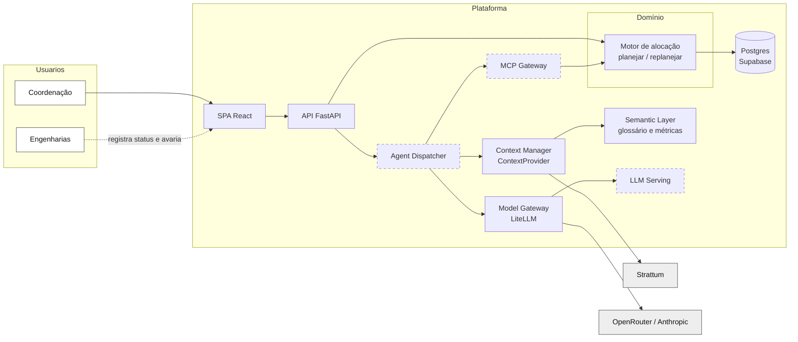

# SPEC · Protótipo de alocação da frota da Veloz

status: aprovado pelo José · 12/11/2026 · Decidido por: José
Fonte do negócio: `docs/01-discovery.md` v0.3. Glossário e dores: `CONTEXT.md`. Números: `PREMISSAS.md`.

## Problema
A coordenação de projetos da Veloz aloca 250 protótipos de R$ 1 milhão ou mais entre 5 engenharias, sem dado. Cada área pede carros para si, com gordura escondida; ninguém vê o carro que a outra libera; atraso e reprovação chegam pelo e-mail semanal. Sobra vira sucata, falta atrasa o lançamento.

## Dores atacadas
D1 a D6 e D8 do `CONTEXT.md`. D7 (multi-projeto) fica no roadmap.

## Escopo do protótipo
| Fatia | Entrega para a coordenação | Requisitos | Dor |
|---|---|---|---|
| 1 | Esqueleto: a tela não calcula nada; ela pede o plano ao backend (a API) e desenha o que recebe. No backend, o pedido atravessa 4 camadas: a rota (`presentation`), o caso de uso (`application`), o motor que monta o plano (`domain`) e a leitura dos dados (`infrastructure`). Detalhe no ADR 0001 | — | D2 |
| 2 | Motor gera o plano compartilhado a partir da lista de testes (ADR 0002); o cenário do processo atual vem da soma dos pedidos por área | RF-01, RF-02, RN-01 a RN-04, RN-06 | D1 |
| 3 | Gantt por protótipo × semana; comparativo pedidos por área × plano compartilhado, com folga de reteste ajustável | RF-03, RF-04, RF-07 | D2, D3 |
| 4 | Status do teste; atraso de +N semanas e falha geram sugestões de troca ou impactados; aceitar cria versão N+1 | RF-05, RF-06, RN-05, RN-07, RN-08 | D4, D5 |
| 4b | Registro de avaria: leve só fica registrada; compromete reuso tira o carro do pool e replaneja. As avarias da versão aparecem na lista "Avarias registradas", ao lado do Gantt, e como ⚠ na linha do carro | RF-08, RN-09 | D6 |
| 4c | Caminho crítico, marco do lançamento, impacto no marco e uso da frota por semana | ADR 0007 | D8 |
| 5 | Copiloto: texto livre → evento → `replanejar` → explicação; a coordenação aprova | ADR 0003 | D4 |
| 5b | Opcional: adapter Postgres (Supabase) no lugar do JSON | ADR 0006 | — |
| 6 | Acabamento, README, ROADMAP, diagrama final | — | — |

## Fora de escopo
Login e perfis por área (a tela tem só um seletor de perfil simulado), solver ótimo, variantes de protótipo, clima e capacidade por engenharia, vários projetos ao mesmo tempo, integração com o BI da Veloz, deploy de produção na AWS. O porquê de cada um está no ADR 0005.

## Quem usa
Sem login, o protótipo não sabe quem está na tela. O seletor "Você está como", no topo, simula os dois perfis: a **engenharia** registra status e avaria; o **gerente da coordenação** aceita ou recusa a proposta (RN-07). A trava é só da tela; a API não confere quem chama. Login de verdade é v2 (ROADMAP).

## Regras do replanejamento (detalhe do RN-05, RN-08 e RN-09)
Nas regras, **A** é o teste que sofreu o imprevisto, **B** é qualquer outro teste marcado no mesmo carro depois dele, **N** é o número de semanas de atraso e **P** é um carro.
- **Atraso de A em +N semanas:** o fim de A anda N semanas. Todo teste B no mesmo carro que começa até o novo fim de A colide.
- **Falha de A, não destrutivo:** A ganha um reteste com a mesma duração, no mesmo carro, logo depois do fim. O que colide com o reteste segue a regra de colisão.
- **Falha de A, destrutivo:** o reteste vai para um carro livre, logo depois do fim de A.
- **Avaria que compromete reuso no carro P, na semana s:** todo teste prometido a P que começa depois de s colide. O teste em andamento na semana s fica no carro até o fim. Avaria leve não muda nada.
- **Colisão de B:** o sistema procura outro carro livre nas mesmas semanas de B, primeiro entre os carros do plano, depois entre os carros da folga de reteste, pelo menor ID. Achou: sugestão "mover B de P1 para P2". Não achou: B e a área dele aparecem como impactados e B sai do plano até alguém decidir.
- Passar da semana 20 também é impacto (RN-06).
- A proposta só vira plano quando o gerente da coordenação aceita (RN-07). Simplificação: aceita-se a proposta inteira, não sugestão por sugestão.

## Arquitetura-alvo

Tracejado é roadmap. No protótipo, a API chama o copiloto direto (sem Dispatcher nem MCP), o `ContextProvider` lê arquivos locais e o banco é JSON em memória, ou o Supabase com `DATA_BACKEND=supabase` (ticket 05b). Cada caixa tem a sua linha em `docs/mapa-arquitetura.md`; o que é tracejado está no `ROADMAP.md`.

## Critérios de aceite
Os do §13 do discovery, um teste automatizado por critério de regra. Mais:
- O teste de fronteira de imports passa (ADR 0001).
- `uv run pytest` passa no backend; `npm run build` passa no frontend.
- O comando do README sobe backend e frontend no PowerShell.
